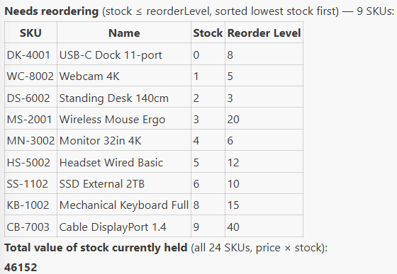

# A/B-валідація MCP (Task D)


**Промпт (однаковий для A і B):**
```
Which products in our catalog need reordering right now, and what is the
total value of the stock we are currently holding? Give me the SKUs and
the total as a number.
```

**Хост / модель:** Claude Code / Sonnet 5
**Сервер під тестом:** `mcp-server/` (tools: `search_inventory`, `check_stock`, `low_stock`; resource: `inventory://catalog`)

## Ground truth

Порахований локально, щоб було з чим звіряти:

```
SKU, що потребують дозамовлення: DK-4001, WC-8002, DS-6002, MS-2001, MN-3002, HS-5002, SS-1102, KB-1002, CB-7003
Загальна вартість запасів: 46152
```

Порахували двома незалежними способами, які збіглися:
1. `materials/ab-question.md`: `cd app && npm run build`, потім
   `node -e "import('./dist/index.js').then(m=>{const c=m.loadCatalog();console.log(m.lowStock(c).map(p=>p.sku).join(', '));console.log(m.inventoryValue(c));})"`
2. Ручна перевірка: прочитано `app/data/catalog.json`, вручну відфільтровано
   `stock <= reorderLevel` (9 SKU) і пораховано `sum(price * stock)` по всіх 24 товарах.

## Прогін A — MCP підключено

**Що зробив агент:** Викликав tool `mcp__catalog__low_stock` (без аргументів) для списку SKU, що потребують дозамовлення, і прочитав ресурс `inventory://catalog` для поля `totalInventoryValue`. Файл `catalog.json` напряму не читав і нічого не рахував вручну.

**Відповідь:**
```
DK-4001, WC-8002, DS-6002, MS-2001, MN-3002, HS-5002, SS-1102, KB-1002, CB-7003
46152
```

**Правильно?** Так, повністю збігається з ground truth — і список SKU, і сума.

## Прогін B — MCP вимкнено

**Як саме вимикали:** Сервер узагалі не був зареєстрований у `.mcp.json` цієї сесії (`{"mcpServers": {}}`) — тобто tools ніколи не були підключені, зроблений перезапуск хоста.

**Що зробив агент:** Читав `app/data/catalog.json` напряму (через Read) і рахував вручну: відфільтрував товари за `stock <= reorderLevel`, відсортував за зростанням stock, і підсумував `price * stock` по всіх 24 позиціях (з проміжним групуванням по 4 для самоперевірки).

**Відповідь:**



**Правильно?** Так, збігається з ground truth.

## Таблиця відмінностей

| Аспект | A (з MCP) | B (без MCP) |
|---|---|---|
| Викликав tool | так, `low_stock` + ресурс `inventory://catalog` | ні — прямий Read `catalog.json` |
| Список SKU повний | так, 9/9 | так, 9/9 |
| Загальна сума точна | так, 46152 | так, 46152 |
| Скільки кроків знадобилось | 2 виклики (1 tool + 1 resource read) | 1 читання файлу + ручні обчислення (фільтрація + підсумовування по 24 рядках) |
| Впевненість відповіді vs її правильність | висока впевненість, обґрунтована — числа взяті з домену, а не пораховані моделлю | висока впевненість, теж обґрунтована цього разу, але через self-consistency check (групове підсумовування), не гарантована архітектурно |
| Презентація результату | стислий рядок — SKU через кому й число, майже дослівно текст, який повернув tool/ресурс | розгорнута markdown-таблиця (SKU, назва, stock, reorderLevel) плюс окремий підсумок суми — агент сам вирішив, як подати сирі дані, бо готового форматованого тексту від MCP не було |

## Висновок

Наявність MCP не змінила кінцевий результат: обидва прогони дали ідентичну, правильну відповідь. Різниця — у механізмі отримання відповіді: з MCP агент отримав числа напряму з домену (`lowStock`/`inventoryValue`, імпортовані з `app/`), тоді як без MCP він виконав арифметику сам і покладався на self-check, щоб не помилитися при підсумовуванні 24 рядків.
